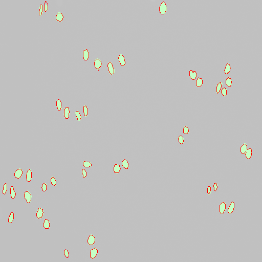

# 🔬 HeLa Cell Segmentation – Live Demo

A Streamlit web app that automatically segments HeLa cells from fluorescence microscopy images using a trained **U-Net with ResNet-34 encoder**.

[](https://your-app-name.streamlit.app)

## 📊 Results

| Metric | Score |
|---|---|
| Mean Dice Score | **95.92 %** |
| Mean IoU | **92.17 %** |
| Dataset | Fluo-N2DL-HeLa (Cell Tracking Challenge) |



## 🚀 How to Run Locally

```bash
git clone https://github.com/YOUR_USERNAME/hela-cell-segmentation
cd hela-cell-segmentation
pip install -r requirements.txt
streamlit run app.py
```

## 🏗️ Architecture

| Component | Detail |
|---|---|
| **Model** | U-Net (`segmentation-models-pytorch`) |
| **Encoder** | ResNet-34, pretrained on ImageNet |
| **Attention** | SCSE (Squeeze-and-Channel Spatial Excitation) |
| **Loss** | ComboLoss = 50% BCE + 50% Dice |
| **Optimizer** | AdamW with differential LR (encoder 1e-5, decoder 1e-3) |
| **Scheduler** | CosineAnnealingWarmRestarts |
| **AMP** | Mixed Precision (FP16) via `torch.amp` |
| **Input size** | 512 × 512 |
| **Epochs** | 30 |

## 📁 Project Structure

```
hela-demo/
├── app.py               # Streamlit demo
├── requirements.txt     # Python dependencies
├── outputs/
│   └── sample_prediction_overlay.png
└── README.md
```

> **Note:** Model weights (`best_unet_model.pt`) are hosted on [Hugging Face Hub](https://huggingface.co/YOUR_HF_USERNAME/hela-cell-segmentation) and downloaded automatically on first run.
